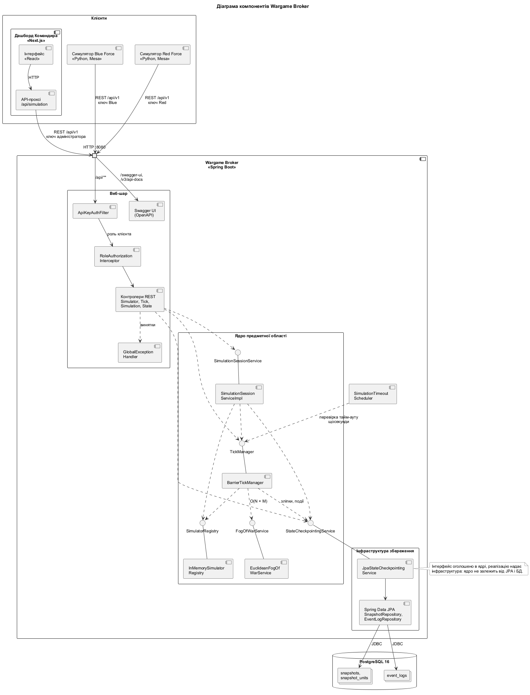
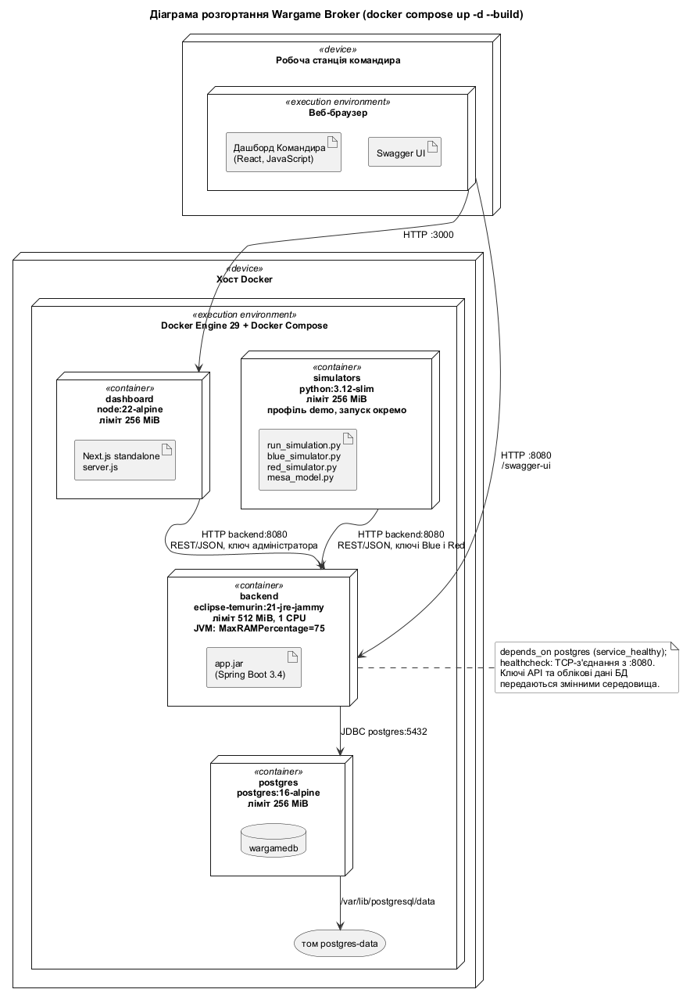

# UML-діаграми

Діаграми описано в PlantUML. Спільний монохромний стиль для друку в записці лежить у `style.iuml`. Згенеровані зображення — в `images/`.

| Діаграма | Джерело | Що показує |
| --- | --- | --- |
| Прецеденти: обмін даними тіку | [use_case_tick_exchange.puml](use_case_tick_exchange.puml) | реєстрація симуляторів, хід тіку, туман війни, зліпки, валідація |
| Прецеденти: керування симуляцією | [use_case_session.puml](use_case_session.puml) | дії командира через дашборд і пауза за тайм-аутом |
| Компоненти | [component.puml](component.puml) | клієнти, шари брокера, інтерфейси ядра та їхні реалізації, PostgreSQL |
| Класи: ядро | [class_domain.puml](class_domain.puml) | модель предметної області, сервіси ядра та їхні реалізації |
| Класи: веб-шар та збереження | [class_web_infrastructure.puml](class_web_infrastructure.puml) | контролери, DTO, безпека, обробка винятків, JPA-сутності й репозиторії |
| Розгортання | [deployment.puml](deployment.puml) | контейнери docker compose, ліміти пам'яті, порти, том БД |
| Розгортання тестового середовища | [deployment_testing.puml](deployment_testing.puml) | Testcontainers, браузери Selenium, JMeter, звіти |
| Життєвий цикл дефекту | [defect_lifecycle.puml](defect_lifecycle.puml) | стани дефекту від New до Closed, включно з Reopened |





## Генерація зображень

Потрібні Java і Graphviz. Команду запускати з цієї папки:

```bash
java -jar plantuml.jar -tpng -o images *.puml
```

`plantuml.jar` можна завантажити з Maven Central: `net.sourceforge.plantuml:plantuml` (діаграми зібрано версією 1.2024.7).
