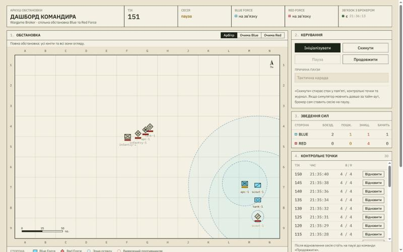

# BR-08. Межі карти змінюються між тіками: з'являється і зникає стовпчик N

| Атрибут | Значення |
| --- | --- |
| ID | BR-08 |
| GitHub Issue | [#9](https://github.com/nikitarybalko/software-components-coursework/issues/9) |
| Заголовок | Межі карти змінюються між тіками: з'являється і зникає стовпчик N |
| Компонент | Дашборд Командира |
| Серйозність | Minor |
| Пріоритет | Medium |
| Відтворюваність | Завжди |
| Спосіб виявлення | Ручне тестування UI |
| Статус | Closed |
| Знайдено у версії | 2223fae |
| Виправлено в коміті | f60b36b |
| Середовище | Ubuntu, ядро Linux 7.0; Docker 29.9 і Docker Compose 5.6: postgres 16-alpine, backend, dashboard, simulators (Python 3.12, Mesa 3); браузер Chromium, вікно 1280 × 860 |
| Вимоги / тест-кейси | FR-10 / TC-FR10-01 |
| Дата виявлення | 06.11.2026 |
| Автор | nikitarybalko |
| Відповідальний | nikitarybalko |

## Передумови

Стек запущено, йде бій, юніти наближаються до краю поля (x ≈ 298).

## Кроки відтворення

1. Відкрити дашборд на http://localhost:3000.
2. Спостерігати за картою, поки юніти рухаються біля правого або нижнього краю поля.

## Очікуваний результат

Аркуш карти має сталий розмір 300 × 200, сітка A–M та 1–8 не змінюється.

## Фактичний результат

Карта розширюється й звужується між тіками: з'являються та зникають стовпчик N і рядок 9, масштаб усієї карти стрибає.

## Вкладення

 Скриншот 06.11.2026 на коміті 2223fae: юніти біля правого краю розширили аркуш до стовпчика N і рядка 9.

## Причина

Межі аркуша обчислювались із запасом 10 одиниць від крайніх юнітів, тож юніт біля краю (x = 298) розширював аркуш до 325.

## Виправлення

Аркуш має фіксований розмір поля симуляторів і розширюється лише тоді, коли юніт справді виходить за межі поля.

## Регресійна перевірка

- Ручний тест-кейс TC-FR10-01; автоматизація запланована в UI-тестах Selenium

## Історія статусів

| Дата | Статус |
| --- | --- |
| 06.11.2026 | New |
| 06.11.2026 | In Progress |
| 06.11.2026 | Fixed |
| 06.11.2026 | Verified |
| 06.11.2026 | Closed |
