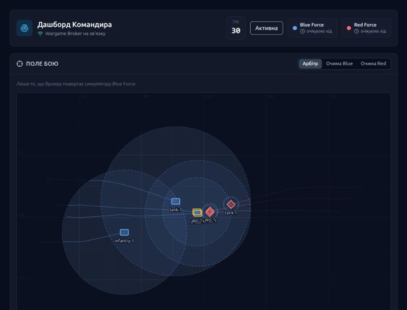

# BR-09. У режимі «Очима Blue» сліди руху противника видно крізь туман війни

| Атрибут | Значення |
| --- | --- |
| ID | BR-09 |
| GitHub Issue | [#10](https://github.com/nikitarybalko/software-components-coursework/issues/10) |
| Заголовок | У режимі «Очима Blue» сліди руху противника видно крізь туман війни |
| Компонент | Дашборд Командира |
| Серйозність | Major |
| Пріоритет | Medium |
| Відтворюваність | Завжди |
| Спосіб виявлення | Ручне тестування UI |
| Статус | Closed |
| Знайдено у версії | робоча копія develop перед комітом 9e9510b |
| Виправлено в коміті | 9e9510b |
| Середовище | Ubuntu, ядро Linux 7.0; Docker 29.9 і Docker Compose 5.6: postgres 16-alpine, backend, dashboard, simulators (Python 3.12, Mesa 3); браузер Chromium, вікно 1280 × 860 |
| Вимоги / тест-кейси | FR-10, FR-3 / TC-FR10-02 |
| Дата виявлення | 05.11.2026 |
| Автор | nikitarybalko |
| Відповідальний | nikitarybalko |

## Передумови

Йде бій, частина юнітів Red поза оглядом Blue.

## Кроки відтворення

1. Відкрити дашборд і перемкнути режим «Очима Blue».
2. Подивитися на ділянки карти поза зонами огляду Blue.

## Очікуваний результат

Поза зонами огляду видно лише туман; про юніти Red, яких Blue не бачить, немає жодної інформації.

## Фактичний результат

Під туманом проступають пунктирні сліди руху всіх юнітів Red, тобто їхні маршрути, хоча самі юніти приховано.

## Вкладення

 Скриншот 05.11.2026: праворуч від зон огляду Blue проступають пунктирні сліди юнітів Red.

## Причина

Сліди малювались для всіх юнітів сцени, включно з противниками, чия історія руху береться з повної обстановки.

## Виправлення

У режимах сторін сліди та зони огляду малюються лише для власних юнітів сторони.

## Регресійна перевірка

- `ChromeDashboardE2ETest#sideViewsHideUnseenEnemies`
- `FirefoxDashboardE2ETest#sideViewsHideUnseenEnemies`

## Історія статусів

| Дата | Статус |
| --- | --- |
| 05.11.2026 | New |
| 05.11.2026 | In Progress |
| 05.11.2026 | Fixed |
| 05.11.2026 | Verified |
| 05.11.2026 | Closed |
